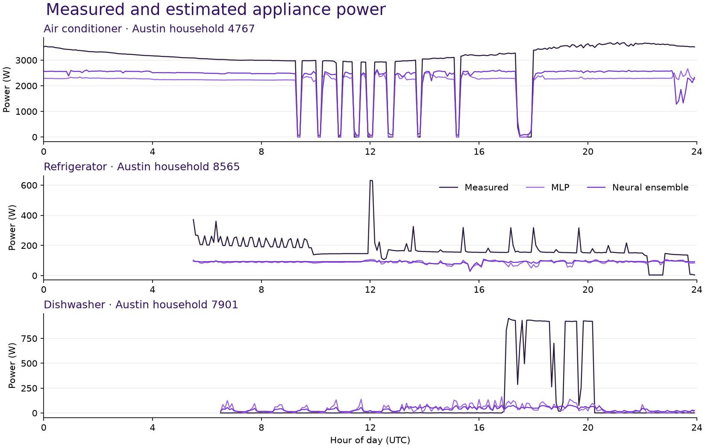

# Unseen-household NILM benchmark

The comparison uses the supplied Austin, California, New York and Puerto Rico one-minute real-power datasets. The [project guide](README.md) documents channels, cleaning, threshold selection, training and reproducibility.

## Household split

| Protocol | Development homes | Test homes | Test household IDs |
|---|---:|---:|---|
| Unseen households | 60 | 18 | 387, 3987, 4031, 4204, 4283, 4767, 5587, 5679, 5938, 7800, 7901, 8342, 8386, 8565, 8574, 8733, 950, 9836 |
| Unseen region · Austin | 53 | 25 | 1642, 2335, 2361, 2818, 3039, 3456, 3538, 4031, 4373, 4767, 5746, 6139, 661, 7536, 7719, 7800, 7901, 7951, 8156, 8386, 8565, 9019, 9160, 9278, 9922 |
| Unseen region · California | 55 | 23 | 1450, 1524, 1731, 203, 2606, 3687, 3864, 3938, 4495, 4934, 5938, 6377, 6547, 7062, 7114, 8061, 8342, 8574, 8733, 9213, 9612, 9775, 9836 |
| Unseen region · New York | 56 | 22 | 1240, 1417, 142, 2096, 2358, 27, 3000, 3488, 3517, 3700, 387, 3996, 4283, 4550, 5058, 558, 5587, 5679, 5982, 5997, 9053, 950 |
| Unseen region · Puerto Rico | 70 | 8 | 11386, 2159, 371, 3987, 4204, 7667, 8997, 939 |

All development household IDs are in [splits.json](results/splits.json).

## Eight-model comparison

The table pools test minutes across regions for the fixed unseen-household models. The complete region and household breakdown, thresholds, class counts and confusion matrices are in [metrics.csv](results/metrics.csv).

| Appliance | Model | Accuracy | Balanced accuracy | Macro F1 | MAE W | RMSE W | ON | OFF | Minimum met |
|---|---|---:|---:|---:|---:|---:|---:|---:|---|
| Air conditioner | Always off | 84.4% | 50.0% | 0.458 | 312.2 | 885.7 | 19,984 | 108,338 | No |
| Air conditioner | Linear | 88.0% | 88.7% | 0.812 | 250.0 | 503.3 | 19,984 | 108,338 | Yes |
| Air conditioner | Gradient boosting | 89.7% | 88.7% | 0.831 | 133.0 | 412.7 | 19,984 | 108,338 | Yes |
| Air conditioner | MLP | 85.5% | 87.5% | 0.785 | 150.6 | 414.7 | 19,984 | 108,338 | Yes |
| Air conditioner | 1D CNN | 85.8% | 87.7% | 0.788 | 153.9 | 381.8 | 19,984 | 108,338 | Yes |
| Air conditioner | GRU | 82.8% | 86.0% | 0.755 | 186.7 | 429.8 | 19,984 | 108,338 | No |
| Air conditioner | LSTM | 84.7% | 86.9% | 0.775 | 251.6 | 467.6 | 19,984 | 108,338 | No |
| Air conditioner | Neural ensemble | 86.3% | 87.9% | 0.793 | 179.8 | 393.9 | 19,984 | 108,338 | Yes |
| Refrigerator | Always off | 42.4% | 50.0% | 0.298 | 71.0 | 103.7 | 79,947 | 58,839 | No |
| Refrigerator | Linear | 61.1% | 57.8% | 0.571 | 58.0 | 74.9 | 79,947 | 58,839 | No |
| Refrigerator | Gradient boosting | 72.4% | 69.7% | 0.700 | 48.9 | 70.5 | 79,947 | 58,839 | No |
| Refrigerator | MLP | 70.7% | 67.9% | 0.681 | 48.8 | 69.2 | 79,947 | 58,839 | No |
| Refrigerator | 1D CNN | 64.6% | 59.5% | 0.568 | 53.2 | 71.9 | 79,947 | 58,839 | No |
| Refrigerator | GRU | 69.9% | 67.0% | 0.671 | 49.0 | 69.5 | 79,947 | 58,839 | No |
| Refrigerator | LSTM | 69.6% | 66.4% | 0.663 | 49.7 | 69.6 | 79,947 | 58,839 | No |
| Refrigerator | Neural ensemble | 70.8% | 68.1% | 0.682 | 49.8 | 69.3 | 79,947 | 58,839 | No |
| Dishwasher | Always off | 89.1% | 50.0% | 0.471 | 16.2 | 106.7 | 14,855 | 121,951 | No |
| Dishwasher | Linear | 69.8% | 59.8% | 0.532 | 23.3 | 105.0 | 14,855 | 121,951 | No |
| Dishwasher | Gradient boosting | 84.5% | 57.1% | 0.575 | 21.7 | 95.4 | 14,855 | 121,951 | No |
| Dishwasher | MLP | 76.6% | 58.2% | 0.552 | 30.8 | 104.3 | 14,855 | 121,951 | No |
| Dishwasher | 1D CNN | 70.9% | 59.9% | 0.537 | 25.3 | 102.8 | 14,855 | 121,951 | No |
| Dishwasher | GRU | 82.0% | 58.7% | 0.578 | 37.7 | 104.5 | 14,855 | 121,951 | No |
| Dishwasher | LSTM | 75.7% | 59.8% | 0.558 | 37.5 | 105.5 | 14,855 | 121,951 | No |
| Dishwasher | Neural ensemble | 73.4% | 60.2% | 0.550 | 32.6 | 103.0 | 14,855 | 121,951 | No |

## Regional transfer

Each row below uses the neural ensemble trained with the named region excluded. The fixed-model figures use the same weights across regions, with a smaller test subset in each region. The protocols differ in test cohort size, so their individual scores need that context.

| Held-out region | Appliance | Accuracy | Balanced accuracy | Macro F1 | MAE W | RMSE W |
|---|---|---:|---:|---:|---:|---:|
| Austin | Air conditioner | 74.1% | 79.3% | 0.720 | 451.5 | 865.4 |
| Austin | Refrigerator | 74.0% | 68.0% | 0.684 | 54.7 | 72.8 |
| Austin | Dishwasher | 54.2% | 56.7% | 0.416 | 36.0 | 108.1 |
| California | Air conditioner | 94.4% | 96.4% | 0.785 | 79.8 | 158.3 |
| California | Refrigerator | 73.1% | 73.4% | 0.731 | 48.3 | 75.3 |
| California | Dishwasher | 91.2% | 73.9% | 0.561 | 29.3 | 82.1 |
| New York | Air conditioner | 76.3% | 60.1% | 0.609 | 326.7 | 710.3 |
| New York | Refrigerator | 68.8% | 67.6% | 0.671 | 48.3 | 65.5 |
| New York | Dishwasher | 78.9% | 61.1% | 0.502 | 37.3 | 109.1 |
| Puerto Rico | Air conditioner | 71.8% | 52.7% | 0.484 | 207.9 | 357.9 |
| Puerto Rico | Refrigerator | 72.2% | 70.6% | 0.635 | 56.2 | 114.4 |

## Power traces

The sampled high-activity days illustrate how both neural estimates follow air-conditioning cycles while smoothing some refrigerator and dishwasher peaks.

## Interpretation

- Air conditioner. Gradient boosting had the highest pooled test macro F1 (0.831) and met the combined minimum targets.
- Refrigerator. Gradient boosting had the highest pooled test macro F1 (0.700) and fell short of the combined minimum targets.
- Dishwasher. GRU had the highest pooled test macro F1 (0.578) and fell short of the combined minimum targets.
- Pooled scores give more weight to regions with more valid samples. Use the per-region and per-household views to see how results vary across datasets and homes.
- Accuracy can be high when OFF dominates. Balanced accuracy, macro F1 and the class counts show how well a model detects ON events.
- Puerto Rico has no usable dishwasher labels. Its randomly held-out households also lack air-conditioner labels, so its air-conditioner comparison uses the full held-out-region protocol.

The dashboard displays measured versus predicted power and the ON/OFF confusion matrix for each evaluated model. See [training_log.csv](results/training_log.csv) for per-epoch validation losses.
